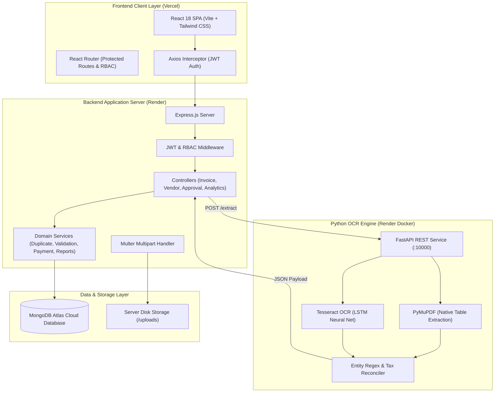
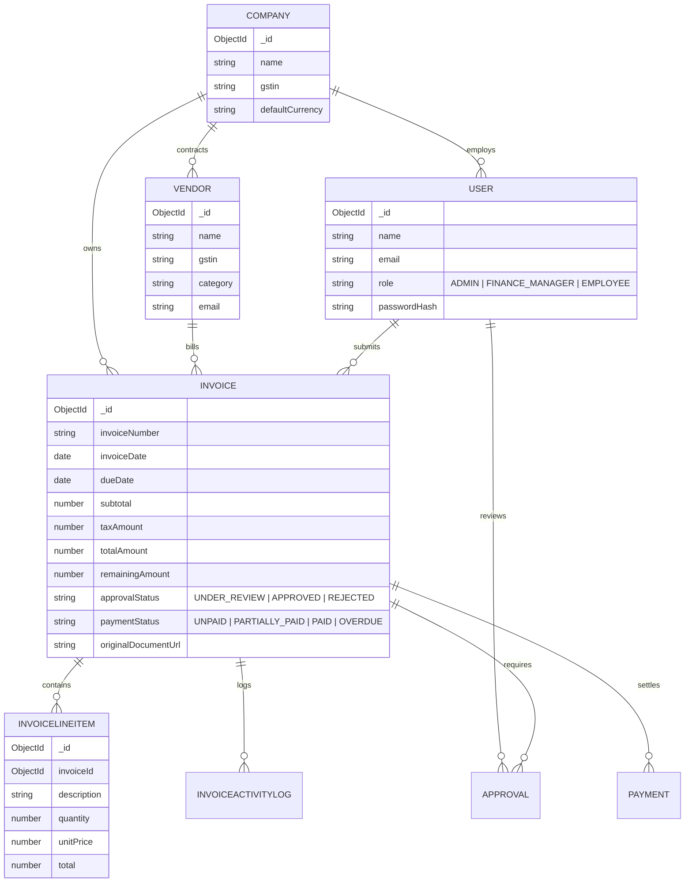

# InvoScan: Invoice Processing & Spend Intelligence Workspace
## Complete Project Report & Presentation (PPT) Guide

---

# PART 1: COMPREHENSIVE PROJECT REPORT

### 1. Project Title & Executive Summary
* **Project Title**: InvoScan – Automated Invoice Processing and Spend Intelligence System
* **Domain**: Financial Technology (FinTech), Optical Character Recognition (OCR), Enterprise Resource Planning (ERP), Accounts Payable (AP) Automation
* **Executive Summary**:
  InvoScan is an automated Accounts Payable (AP) automation and corporate expenditure intelligence platform. The system bridges the gap between unstructured document receipt ingestion (PDFs, scans, digital receipts) and enterprise financial reporting. Powered by a specialized Python OCR microservice utilizing PyMuPDF table matrix parsing and Tesseract neural OCR, InvoScan extracts vendor details, GSTIN compliance records, itemized line items, and tax calculations. It automates duplicate detection, enforces multi-tier role-based approval workflows (Employee, Finance Manager, Admin), manages partial payment settlements, and delivers real-time spend analytics through MongoDB aggregation pipelines.

---

### 2. Problem Statement & Motivation
In modern corporate environments, invoice handling remains predominantly manual, causing:
1. **Inefficient Manual Ingestion**: Finance employees spend 30–40% of their working hours manually transcribing invoice dates, line items, and tax amounts into spreadsheets or ERPs.
2. **Duplicate Payments & Financial Leakage**: Without automated fuzzy matching, companies inadvertently pay duplicate invoices submitted across different departments or billing cycles.
3. **Delayed Approval Cycles**: Invoices sit in email inboxes awaiting manager approvals, resulting in late payment penalties and missed early-settlement vendor discounts.
4. **GST & Regulatory Compliance Errors**: Manual tax calculations frequently miscalculate CGST, SGST, and IGST components or overlook missing vendor GSTIN registration numbers.
5. **Data Silos in Expenditure**: Management lacks real-time visibility into vendor concentration, category-level spending spikes, and outstanding company liabilities.

---

### 3. Project Objectives & Scope
* **Automated Document Extraction**: Extract structured data (vendor name, invoice number, dates, line items, amounts, taxes) from PDFs and images with >90% confidence.
* **Intelligent Entity Recognition**: Accurately recognize Indian GSTIN numbers, contact details, and tabular pricing matrices.
* **Proactive Anomaly & Duplicate Detection**: Flag identical or near-duplicate invoices using multi-parameter heuristics (vendor ID + invoice number + total amount).
* **Role-Based Access Control (RBAC)**: Secure financial actions across three distinct roles:
  * **Employee**: Draft ingestion, personal submission tracking.
  * **Finance Manager**: Invoice verification, line-item adjustments, approval/rejection queue, payment recording.
  * **Admin**: Complete system oversight, user role provisioning, company settings, and financial audits.
* **Settlement Tracking**: Support full, partial, and installment payment recording with automated remaining liability calculations.
* **Spend Intelligence**: Compute spending run-rates, top vendor liabilities, and departmental breakdowns using server-side database aggregations.
* **Multi-Format Compliance Reporting**: Provide one-click generation of audit-ready CSV, Excel (.xlsx), and PDF reports.

---

### 4. System Architecture & Component Interaction

---

### 5. Detailed Module Breakdown

#### Module 1: AI/OCR Ingestion Microservice (`ocr-service/`)
* **Technology**: Python 3.10, FastAPI, PyMuPDF (`fitz`), Tesseract OCR, OpenCV.
* **Functionality**:
  * Receives uploaded documents via multipart POST.
  * Detects document format: Native PDF vs. Scanned Image.
  * For native PDFs: Executes PyMuPDF `find_tables()` to parse column coordinates (Description, Qty, Unit Rate, Total).
  * For scanned PDFs/Images: Invokes OpenCV preprocessing (grayscale, Otsu thresholding) and passes images to Tesseract OCR engine.
  * Regex Heuristics:
    * **GSTIN**: `\b[0-9]{2}[A-Z]{5}[0-9]{4}[A-Z]{1}[1-9A-Z]{1}Z[0-9A-Z]{1}\b`
    * **Dates**: Multi-pattern match supporting `DD/MM/YYYY`, `DD-MM-YYYY`, `DD MMM YYYY`, while excluding date-of-birth (DOB) false positives.
    * **Tax Reconciler**: Distinguishes zero-tax exemptions from standard 5%, 12%, 18%, 28% GST brackets.

#### Module 2: REST API & Business Logic (`backend/`)
* **Technology**: Node.js, Express, Mongoose, JWT, Multer.
* **Functionality**:
  * **3-Tier Structure**: `routes/` -> `controllers/` -> `services/` -> `models/`.
  * **Duplicate Detection Service**: Runs compound queries checking for identical invoice numbers from the same vendor or identical monetary totals within a 30-day window.
  * **Validation Service**: Enforces mathematical integrity (`subtotal + tax - discount === totalAmount`) and chronology (`dueDate >= invoiceDate`).
  * **Audit Trail**: Every upload, edit, approval, rejection, and payment is recorded in `InvoiceActivityLog` with user ID, timestamp, and metadata.

#### Module 3: Frontend User Experience (`frontend/`)
* **Technology**: React 18, Vite, Tailwind CSS, Lucide Icons.
* **Functionality**:
  * **Split-Screen Ingestion**: Displays real-time PDF/image document preview on the left while extracted form fields are reviewed and edited on the right.
  * **Dynamic Calculations**: Modifying line item quantities or rates triggers immediate recalculation of subtotal, tax splits, and grand totals.
  * **Approval Queue Management**: Filterable kanban/table showing pending reviews with one-click approve/reject actions.
  * **Vendor Ledger**: 360-degree view of vendor spend history, payment status, and pending liabilities.

---

### 6. Database Schema & Data Models (MongoDB Atlas)

---

# PART 2: SLIDE-BY-SLIDE PRESENTATION (PPT) GUIDE

Use this 12-slide layout for your project presentation, review, or viva:

---

### Slide 1: Title Slide
* **Slide Title**: InvoScan: Intelligent Invoice Processing & Spend Analytics Platform
* **Subtitle**: Automated Optical Character Recognition, Approval Workflows & Enterprise Financial Intelligence
* **Presenter Info**: Your Name | Institution / Organization | Date
* **Visual**: Clean, professional slide with InvoScan logo, dashboard preview, and tech stack badges (React, Node, Python, MongoDB).

---

### Slide 2: The Problem (Current Industry Challenges)
* **Heading**: The Accounts Payable Bottleneck
* **Bullet Points**:
  * **Manual Transcription**: Finance teams spend up to 40% of their workday typing invoice details from paper/PDFs.
  * **Costly Errors & Duplicates**: Inadvertent duplicate payments and missed tax calculations cost companies millions annually.
  * **Lack of Real-time Visibility**: Spending analytics are locked in silos, preventing proactive budget tracking and vendor negotiation.
  * **Sluggish Approval Chains**: Multi-department email approvals lead to processing delays and late payment penalties.

---

### Slide 3: The Solution (InvoScan Platform)
* **Heading**: End-to-End AP Automation & Spend Intelligence
* **Key Pillars**:
  1. **AI Document Ingestion**: Instant data extraction from invoices, bills, and fee receipts using PyMuPDF and Tesseract.
  2. **Automated Fraud & Duplicate Shield**: Real-time cross-referencing against vendor history and duplicate algorithms.
  3. **Role-Based Workflow Automation**: Streamlined review, approval, and rejection queues tailored for Employees and Finance Managers.
  4. **Executive Spend Analytics**: Real-time interactive dashboards showing spend run-rates, department allocations, and liabilities.

---

### Slide 4: High-Level Architecture
* **Heading**: Cloud-Native 3-Tier Architecture
* **Components**:
  * **Frontend**: React 18 SPA hosted on **Vercel Global Edge Network**.
  * **Application Server**: Node.js / Express REST API hosted on **Render**.
  * **AI/OCR Microservice**: Python FastAPI + PyMuPDF + Tesseract packaged in a Docker container on **Render**.
  * **Database**: Managed **MongoDB Atlas** M0 Cloud Cluster.
* **Key Highlight**: Separation of concerns between high-throughput Node.js I/O and heavy computational OCR processing in Python.

---

### Slide 5: Deep Dive: OCR & Table Matrix Extraction
* **Heading**: Intelligent Document Parsing Engine
* **Bullet Points**:
  * **Dual-Engine Processing**:
    * Vector PDFs &rarr; Native text streams and table boundary extraction (`page.find_tables()`).
    * Scanned PDFs & Images &rarr; OpenCV image enhancement + Tesseract LSTM neural character recognition.
  * **Entity Extraction Rules**:
    * Indian GSTIN regex validation.
    * Intelligent date normalization (`DD/MM/YYYY`, `DD-MM-YYYY`, `DD-MMM-YYYY`).
    * Filtering out false positives (e.g. Applicant DOB vs. Invoice Issue Date).
  * **GST Tax Reconciler**: Automatically identifies 0% tax exemptions vs. taxable slabs (5%, 12%, 18%, 28%).

---

### Slide 6: Multi-Tier Approval Workflow (RBAC)
* **Heading**: Role-Based Governance & Access Control
* **Three Structured Roles**:
  * **Admin**: System-wide configuration, company master settings, user provisioning, global overrides.
  * **Finance Manager**: Full approval queue authority, invoice verification, rejection with mandatory audit reasons, settlement recording.
  * **Employee**: Self-service invoice ingestion, draft tracking, and read-only visibility into personal submissions.
* **Audit Trail**: Every state transition (`UNDER_REVIEW` &rarr; `APPROVED` &rarr; `PAID`) creates an immutable activity log entry.

---

### Slide 7: Fraud Prevention & Duplicate Detection
* **Heading**: Safeguarding Corporate Capital
* **How It Works**:
  1. **Multi-Parameter Matching**:
     * Exact vendor name + invoice number match.
     * Identical monetary total from the same vendor within 30 days.
  2. **Proactive UI Warnings**: An amber warning banner alerts the finance reviewer before an invoice can be finalized.
  3. **Mathematical Validation Engine**: Confirms that line items, discounts, and tax rates reconcile to the grand total.

---

### Slide 8: Spend Intelligence & Analytics Dashboard
* **Heading**: Turning Invoices into Strategic Financial Insights
* **Key Metrics**:
  * **Monthly Spend Run-Rate**: Bar charts comparing monthly invoiced commitments vs. settled payments.
  * **Department Allocations**: Breakdown across IT, Operations, Marketing, Logistics, and Services.
  * **Vendor Concentration**: Highlights top suppliers and outstanding credit exposure.
  * **Cash Flow Management**: Real-time display of Active Liabilities and Overdue Bills.

---

### Slide 9: Payment Settlement & Multi-Format Reporting
* **Heading**: Complete Accounts Payable Lifecycle
* **Settlement Tracking**:
  * Supports multiple payment modes: UPI, NEFT/RTGS, Corporate Card, Cheque, Cash.
  * Tracks partial payments and auto-calculates remaining liability balance.
* **Compliance Reporting**:
  * **PDF Audit Reports**: Downloadable branded invoices with itemized tables.
  * **Excel Workbooks (.xlsx)**: Formatted spreadsheets with auto-filtering for accounting teams.
  * **CSV Streaming**: Universal data export ready for ERP or Tally integration.

---

### Slide 10: Tech Stack Summary
* **Heading**: Modern, Enterprise-Grade Technology Stack
* **Table of Tech**:
  * **Frontend**: React 18, Vite, Tailwind CSS, React Router, Lucide Icons, Axios.
  * **Backend**: Node.js, Express.js, Mongoose, Multer, Express-Validator, JWT, Bcrypt.js.
  * **AI/OCR**: Python 3.10, FastAPI, PyMuPDF (fitz), Tesseract OCR, OpenCV, Pillow.
  * **Reporting**: PDFKit, ExcelJS, CSV-Stringify.
  * **DevOps & Cloud**: Vercel, Render Docker, MongoDB Atlas, Git/GitHub CI/CD.

---

### Slide 11: Live Demonstration & Results
* **Heading**: Live Application Highlights
* **Demo Steps to Showcase**:
  1. **Login**: Authenticating with Admin / Finance Manager credentials.
  2. **Invoice Upload**: Uploading an Indian utility bill or supermarket receipt.
  3. **Real-time Extraction**: Demonstrating extracted vendor, date, line items, and 0%/18% GST calculation.
  4. **Approval Flow**: Approving the invoice and recording a settlement payment.
  5. **Analytics**: Viewing the updated spend run-rate on the dashboard.

---

### Slide 12: Future Roadmap & Conclusion
* **Heading**: Conclusion & Future Horizons
* **Conclusion**:
  * InvoScan successfully eliminates manual invoice entry, prevents payment duplicates, and delivers instant financial intelligence on modern cloud infrastructure.
* **Future Enhancements**:
  * **ERP Webhooks**: Direct 2-way sync with SAP, Oracle NetSuite, and QuickBooks.
  * **E-Way Bill & E-Invoice Integration**: Direct verification against the Indian GST / NIC portal API.
  * **AI LLM Reasoning**: Natural language conversational assistant for asking complex spending questions (e.g. *"How much did we spend on cloud servers last quarter?"*).
