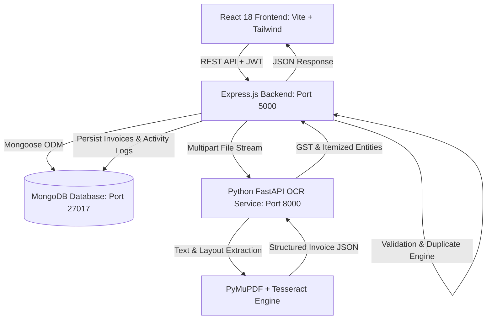

# InvoScan | Invoice Processing and Spend Intelligence Workspace

An enterprise-grade, full-stack web workspace designed for modern finance and accounting teams. InvoScan automates the entire invoice lifecycle—from document upload and optical character recognition (OCR) with Indian GST extraction, to approval workflows, multi-stage payment tracking, and automated spend intelligence analytics.

---

## 1. Problem Statement & Objectives

### The Problem
Manually processing vendor invoices involves tedious data entry, high human error rates, delayed payments, missed early-settlement discounts, and vulnerability to duplicate or fraudulent billing. Organizations often lack unified spend visibility across software subscriptions, hardware procurement, logistics, and consulting services.

### Objectives
- **End-to-End Automation**: Ingest unstructured PDF/image invoices and extract structured financial records using Python FastAPI and PyMuPDF/Tesseract.
- **Enterprise Controls**: Multi-tier role-based access control (Admin, Finance Manager, Employee) with strict company-level tenant isolation.
- **Compliance & GST Intelligence**: Support Indian GST tax regimes (CGST, SGST, IGST) with real-time tax validation and Input Tax Credit (ITC) tracking.
- **Proactive Anomaly Detection**: Rule-based detection for duplicate bills, price outliers (>1.8x vendor average), and unusual department spending spikes.
- **Actionable Financial Reporting**: Instant exports in PDF, Excel, and CSV formats alongside Recharts interactive visualizations.

---

## 2. Technology Stack

| Layer | Technologies |
|---|---|
| **Frontend** | React 18, Vite, JavaScript, Tailwind CSS, Lucide React, Recharts, React Router DOM v6, Axios |
| **Backend** | Node.js (v20+ / v22), Express.js, REST Architecture, JWT Authentication, Bcrypt.js, Multer |
| **Database** | MongoDB (v7+), Mongoose ODM, Decimal financial math, Aggregation pipelines |
| **OCR Microservice** | Python 3.10+, FastAPI, Uvicorn, PyMuPDF (fitz), Tesseract OCR, Pillow, OpenCV |
| **Reporting & Export** | PDFKit, ExcelJS, csv-stringify |

---

## 3. System Architecture & Processing Workflow



### Complete Lifecycle Workflow
1. **Upload**: User uploads invoice document (PDF, JPG, PNG up to 10MB).
2. **OCR Ingestion**: Express forwards the file to the Python FastAPI microservice.
3. **Structured Entity Recognition**: Python extracts Vendor Name, GSTIN, Invoice Number, Issue Date, Due Date, PO Number, Subtotal, CGST, SGST, IGST, Grand Total, and Line Items.
4. **Validation & Duplicate Engine**: System verifies math formulas and flags duplicate invoices (same vendor & invoice number, or duplicate amounts within 45 days).
5. **Interactive Review**: User reviews and corrects extracted fields in an editable verification form with confidence ratings.
6. **Approval Queue**: Finance Managers and Admins audit submissions and approve or reject with mandatory comments.
7. **Payment Settlement**: Partial and full payments are recorded with transaction IDs; the system auto-calculates remaining balances and overdue flags.
8. **Spend Analytics**: Real-time aggregation pipelines update KPIs, category allocations, vendor concentrations, and rule-based anomaly alerts.

---

## 4. Repository Structure

```text
Invoice Processing and Spend Intelligence/
├── package.json               # Root orchestrator scripts
├── backend/                   # Node.js Express Backend
│   ├── .env                   # Environment configuration
│   ├── package.json
│   ├── uploads/               # Secure document storage
│   └── src/
│       ├── app.js             # Express app setup & security middleware
│       ├── server.js          # Server bootstrap & DB connection
│       ├── config/            # database.js, env.js, cors.js
│       ├── controllers/       # auth, dashboard, invoice, vendor, approval, payment, analytics, report
│       ├── models/            # Company, User, Vendor, Invoice, InvoiceLineItem, Approval, Payment, Notification, AuditLog
│       ├── middleware/        # auth, role, upload, error, validation
│       ├── services/          # ocrService, validationService, duplicateDetectionService, paymentService, analyticsService, reportService
│       ├── routes/            # REST API route definitions
│       ├── utils/             # seed.js, currencyUtils.js, dateUtils.js
│       └── tests/             # integration.test.js
├── frontend/                  # React 18 + Vite Frontend
│   ├── package.json
│   ├── vite.config.js
│   ├── tailwind.config.js
│   └── src/
│       ├── main.jsx           # React DOM root & AuthProvider
│       ├── App.jsx            # Protected routes & navigation
│       ├── index.css          # Design tokens & enterprise styling
│       ├── context/           # AuthContext.jsx
│       ├── services/          # api.js, authService, invoiceService, vendorService, analyticsService, reportService
│       ├── pages/             # Login, Register, Dashboard, InvoiceList, InvoiceUpload, InvoiceDetails, InvoiceEdit, Approvals, Vendors, VendorDetails, SpendAnalytics, Reports, Notifications, Settings
│       └── components/        # layout, dashboard, common, invoices, vendors
└── ocr-service/               # Python FastAPI OCR Microservice
    ├── requirements.txt
    ├── main.py                # FastAPI HTTP application (Port 8000)
    └── extractor.py           # PyMuPDF & Tesseract invoice parsing engine
```

---

## 5. Prerequisites & Local Environment Setup

Ensure the following runtimes are installed on your Windows machine:
1. **Node.js**: v18+ (tested on v22.20.0).
2. **Python**: 3.10+ (tested on Python 3.10.0).
3. **MongoDB**: Local MongoDB Community Server running on `mongodb://127.0.0.1:27017`.
4. **Tesseract OCR (Optional for scanned images)**:
   - PyMuPDF handles 100% of standard digital PDF invoices natively.
   - For scanned image OCR, install Tesseract via Windows Winget:
     ```powershell
     winget install UB-Mannheim.TesseractOCR
     ```
   - Standard path: `C:\Program Files\Tesseract-OCR\tesseract.exe` (automatically detected).

---

## 6. Installation & Execution Instructions

### Step 1: Database Seeding (Pre-populates 34 realistic invoices & 10 suppliers)
```powershell
cd backend
npm install
npm run seed
```

### Step 2: Set up Python OCR Service
```powershell
cd ocr-service
python -m venv venv
.\venv\Scripts\pip install -r requirements.txt
```

### Step 3: Run the Services

Launch each service in separate terminal windows:
```powershell
# Terminal 1: Python OCR Microservice (Port 8000)
cd ocr-service
.\venv\Scripts\uvicorn main:app --host 127.0.0.1 --port 8000 --reload

# Terminal 2: Node.js Express API (Port 5000)
cd backend
npm run dev

# Terminal 3: Vite React Frontend (Port 5173)
cd frontend
npm run dev
```

---

## 7. Demo Accounts & Credentials

The seed script initializes three realistic roles under **Apex Innovations Technologies Pvt Ltd**:

| Role | Email | Password | Permissions |
|---|---|---|---|
| **Administrator** | `admin@invoscan.com` | `admin123` | Full system access, vendor management, approvals, analytics, company settings |
| **Finance Manager** | `finance@invoscan.com` | `finance123` | Upload invoices, approve/reject, record settlements, export reports |
| **Employee** | `employee@invoscan.com` | `employee123` | Upload invoices, track own submissions, view authorized invoices |

*Note: The login page includes convenient one-click demo credentials buttons for instant access.*

---

## 8. API Documentation

### Authentication
- `POST /api/auth/register` — Create company workspace & admin user
- `POST /api/auth/login` — Authenticate and receive JWT access token
- `GET /api/auth/me` — Retrieve active session profile
- `PUT /api/auth/change-password` — Change password

### Dashboard & Analytics
- `GET /api/dashboard/summary?period=30d` — KPI cards and period-over-period trend comparisons
- `GET /api/dashboard/monthly-spending?months=12` — Historical monthly expenditure & settlements
- `GET /api/dashboard/category-spending` — Departmental category breakdown
- `GET /api/dashboard/vendor-spending` — Top 5 spending suppliers
- `GET /api/dashboard/upcoming-payments` — Invoices due in the next 30 days
- `GET /api/analytics/overview?period=3m` — Spend intelligence, vendor concentration, & dynamic AI highlights
- `GET /api/analytics/anomalies` — Rule-based anomaly detection alerts

### Invoices & OCR
- `GET /api/invoices` — Multi-filtered invoice listing (search, status, category, date, pagination)
- `GET /api/invoices/:id` — Invoice details, line items, audit history, and settlements
- `POST /api/invoices/upload` — Multer upload forwarded to Python OCR service
- `GET /api/invoices/:id/document` — Stream original uploaded document
- `PUT /api/invoices/:id` — Update / correct invoice fields and line items
- `DELETE /api/invoices/:id` — Delete invoice (admin / finance manager)

### Approvals & Payments
- `GET /api/approvals` — Pending manager approval queue
- `POST /api/approvals/:id/approve` — Approve invoice
- `POST /api/approvals/:id/reject` — Reject invoice (requires mandatory comment)
- `GET /api/payments` — Payment ledger records
- `POST /api/payments` — Record partial or full payment

### Reports
- `GET /api/reports/invoices` — Filtered invoice report dataset
- `GET /api/reports/export/pdf` — Download formatted PDF report
- `GET /api/reports/export/excel` — Download Excel spreadsheet (.xlsx)
- `GET /api/reports/export/csv` — Download CSV dataset

---

## 9. Verification & Automated Testing

The workspace includes a complete native integration test suite verifying end-to-end communication across React, Express, MongoDB, and Python OCR:
```powershell
cd backend
npm test
```
**Test Results:**
- `1. Authentication`: 3 demo logins pass
- `2. Dashboard`: MongoDB aggregation pipelines pass
- `3. Invoice OCR Upload`: Real PDF processing via Python FastAPI passes
- `4. Duplicate Detection`: Matching rules pass
- `5. Approval Workflow`: Role-based authorization & manager approvals pass
- `6. Payment Tracking`: Partial payments and balance calculations pass
- `7. Spend Intelligence`: Tax analytics and anomaly detection pass
- `8. Report Generation`: PDF, Excel, and CSV file exports pass
